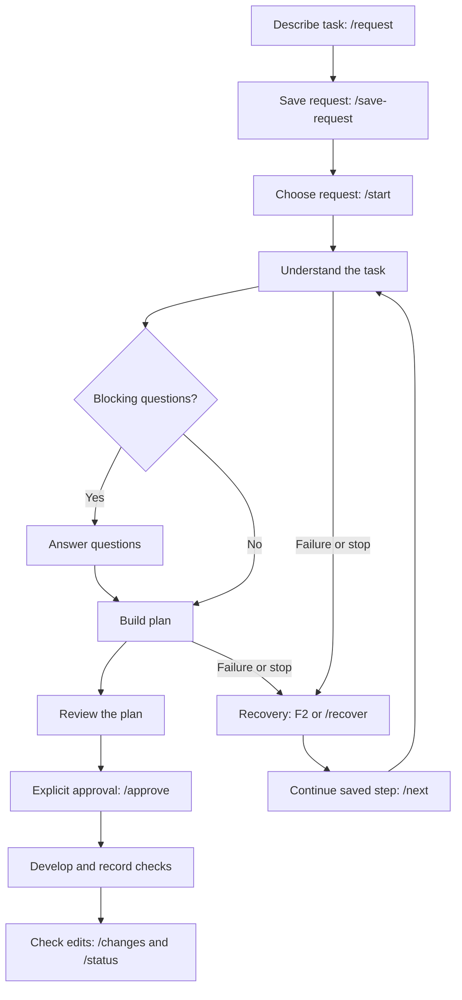

# Working in Forge chat

Describe a task with `/request`, save the draft, then use `/start` to choose the request. Forge prepares the work, asks only blocking questions, and builds a plan. Read the plan before entering `/approve` to start development.

Press **F2** to see a labeled Continue action for your current step. This opens a question, retries preparation, opens plan review, or shows development results. It never approves a plan for you.

While you are writing a request or answering a question, F2 returns you to the message box and keeps your unsent text. When a request draft is ready, Continue offers to save it. A failed model reply opens recovery options; a development turn limit points you to settings.

You can reopen a saved plan with Continue even after closing its previous review. Read it before approving. The inactive Activity panel hides while a plan or selection menu is open to leave more room for reading. When you move back through the conversation, incoming streamed text keeps your reading position; return to the end to follow new text.

Type `/` to browse everyday commands using Up/Down. Tab or Enter fills the selected command; Enter sends it. Use `/advanced` for a selectable menu of individual workflow stages and additional tools. A typed prefix also finds advanced commands.

Use `/ask` for advice during a question or request prompt. `/logs` exports diagnostics to `.forge/logs`. After development, inspect `/changes` and `/status` for saved edits, recorded checks, and outstanding acceptance review.
